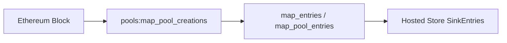

# Hosted Store compatibility package

`evm_dex_foundational_store` v0.7.0 preserves the `map_entries` entrypoint while
using the single Block decoder in
[`dex-swaps-pools` v0.9.0](../dex-swaps-pools/README.md).



Both local map names are `use` aliases of `pools:map_pool_entries`. They select
the same decoder and adapter; they are not successive stages. The manifest has
one package import, no protocol `map_events` inputs, and no separate Rust crate
or WASM binary. For the full four-module API, import the canonical pool package.

The existing Hosted Store contract is retained:

- Output: `sf.substreams.foundational_store.model.v2.SinkEntries`.
- Keys: raw 20-byte addresses or 32-byte pool IDs, including leading zeroes.
- Values: encoded `dex.foundational_store.v1.Pool { tokens, factory }` in `Any`.
- Type URL: `type.googleapis.com/dex.foundational_store.v1.Pool`.
- Policy: `if_not_exist = true`; the first stored value is retained.

Empty batches also carry that policy. Metadata absent from a creation record is
not later enriched. See the canonical package for coverage, native exports,
legacy-store access, source requirements and registry limitations.

Build from the repository root:

```sh
make -C dex-swaps-pools-foundational-store pack
substreams info spkg/evm-dex-foundational-store-v0.7.0.spkg
```

The Makefile first builds and packs the canonical dependency. The released
`evm-dex-foundational-store-v0.6.0.spkg` remains unchanged. This facade preserves
entrypoint and value compatibility; its new module graph is not a guarantee of
cursor, cache or deployment continuity. Existing v0.6.0 imports retain their
original eleven-protocol graph until explicitly upgraded.

The old graph grouped observations by protocol and could emit repeated keys.
The unified decoder follows legacy-store transaction/log order and keeps the
first candidate per key in each block. Conflicting same-block observations can
therefore produce a different first stored value than v0.6.0. This is wire and
entrypoint compatibility, not a guarantee of identical historical datasets.
