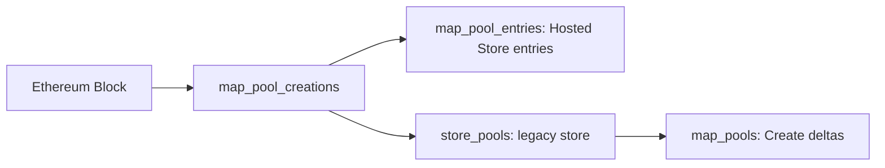

# EVM pool creation and stores

`dex-swaps-pools` v0.9.0 decodes pool creation once from a single
`sf.ethereum.type.v2.Block`, then feeds independent legacy and Hosted Store
outputs. It uses the reusable [`dex-pools`](../dex-pools) Rust decoder and shared
`substreams-abis` bindings. There are no per-protocol `map_events` imports.

The module names and graph match the SVM pool package. EVM retains its existing
`dex.foundational_store.v1` messages and address conventions.



| Module | Input | Output and meaning |
| --- | --- | --- |
| `map_pool_creations` | One Ethereum Block source | `dex.foundational_store.v1.Pools`: decoded observations in this block, before cross-block storage. |
| `map_pool_entries` | `map_pool_creations` | `sf.substreams.foundational_store.model.v2.SinkEntries` with `if_not_exist = true`, including empty batches. |
| `store_pools` | `map_pool_creations` | Legacy `set_if_not_exists` store of `dex.foundational_store.v1.Pool`. |
| `map_pools` | `store_pools` deltas | `dex.foundational_store.v1.Pools` containing only newly created store keys. |

Hosted Store ingestion uses `map_pool_entries` directly. It does not depend on
`store_pools` or `map_pools`. An observation in `map_pool_creations` does not
imply that the pool was absent from earlier blocks. Repeated keys within a block
keep the first decoded candidate, preserving the existing legacy first-write
value; the adapters perform no additional decoding.

## Shared value and key contract

The existing value schema is unchanged:

```protobuf
message Pool {
  repeated bytes tokens = 1;
  bytes factory = 2;
}
```

| Surface | Key | Value |
| --- | --- | --- |
| `Pools.pools[].address` | Lowercase hexadecimal without `0x` | `PoolCreated.pool` |
| Legacy `store_pools` | The same hexadecimal text | Encoded `dex.foundational_store.v1.Pool` |
| Hosted Store | Raw key bytes | The same encoded `Pool` in `Any`, with type URL `type.googleapis.com/dex.foundational_store.v1.Pool` |

Keys retain all 20 bytes of a contract address or all 32 bytes of a pool ID
(such as Uniswap V4), including leading zeroes. A 32-byte ID must not be shortened
to an address. Token order and the optional factory bytes are preserved; missing
factory metadata is an empty byte field under this existing proto3 contract.

Both storage branches keep the first value for a key. They apply that policy
independently; neither branch enriches a previously stored empty field. Legacy
writes use ordinal zero, which does not represent EVM execution order. This
minimal schema contains no creation position, so its availability cannot prove
that a pool existed before a particular swap within the same block. Hosted
Store reads are block-scoped. See the official
[Hosted Store feed documentation](https://docs.substreams.dev/how-to-guides/hosted-services/hosted-store-substreams-feed).

## Decoder coverage and limits

The shared ABI collectors cover Uniswap V1–V4, Aerodrome, Kyber Elastic,
TraderJoe, Balancer V3, Bancor, SunPump, and the supported CurveFi factory and
direct-constructor layouts. This is creation metadata, not live reserves, pool
updates, token metadata, or a complete registry of every historical deployment.
Trace-dependent CurveFi identities require the relevant call information;
receipt-only input cannot establish a constructor-created pool's address.
CurveFi retains the legacy constructor-tail and first-CREATE heuristics. These
can misattribute unrelated or multi-CREATE deployments; the records remain
heuristic metadata, without a claim of verified protocol identity.

The existing metadata contract remains deliberately small. Uniswap V1 records
its emitted token; Bancor events may not supply any tokens; CurveFi meta-pool
events may supply only the newly added coin. Missing assets are not reconstructed
through RPC or inferred from later swaps. These omissions persist under the
first-write policy. Protocol-specific initialization fields remain available
through the individual DEX event packages.

A deployment only knows creations in the processed range and supported layouts.
Starting near the chain head cannot recover older inactive pools. Snapshot
bootstrap, address reuse, and changes to previously stored metadata require an
explicit registry policy.

## Native callers

Native Rust callers can depend on [`dex-pools`](../dex-pools) and consume
`PoolEntry { address, tokens, factory }` records before either storage adapter:

- `project(&Block)` returns the block's decoded entries.
- `decode_log(&Log, create_address)` decodes one log with optional creation context.
- `decode_log_bytes(address, topics, data, create_address)` accepts borrowed
  bytes from another transport model and copies one log into the shared ABI
  model, without serializing or converting a whole block.
- `decode_curvefi_init(&TransactionTrace)` exposes the legacy constructor heuristic.

Raw decoding alone does not establish that a log belongs to a committed
transaction. The optional creation context is supplied by the caller; it is not
independent proof of a factory event's pool identity.

This EVM crate retains the existing `substreams-abis` 1.5 and
`substreams-ethereum` 0.11 dependency family. It is callable from native Rust,
but its dependency graph still includes Substreams SDK crates; it is not the
runtime-free SVM dependency contract. See the native crate's API documentation
and transport tests for exact supported entrypoints.

## Compatibility and packaging

The legacy `store_pools` and `map_pools` module names, hexadecimal keys and value
wire types remain available. New consumers should import
`spkg/dex-swaps-pools-v0.9.0.spkg`.

[`dex-swaps-pools-foundational-store`](../dex-swaps-pools-foundational-store)
v0.7.0 is a compatibility manifest. Its existing `map_entries` entrypoint aliases
this package's `map_pool_entries`; both return identical Hosted Store values.
The facade has one package import and no independent decoder binary.

The previous Hosted Store graph grouped observations by protocol. The unified
graph follows the legacy store's transaction/log order and keeps the first
candidate per key within the block. Conflicting same-block observations can
therefore select a different value than the old Hosted Store graph. Wire and
entrypoint compatibility do not imply identical historical datasets.

Released v0.8.0 legacy and v0.6.0 foundational packages remain unchanged. The new
graph changes module hashes, so identical wire types do not imply that a previous
cursor, cached store or hosted deployment can be reused. Existing consumers
pinned to old package versions retain their old graph until explicitly upgraded.

```sh
cargo test --locked -p dex-pools -p dex-swaps-pools
make -C dex-swaps-pools pack
make -C dex-swaps-pools-foundational-store pack
substreams info spkg/dex-swaps-pools-v0.9.0.spkg
```

These commands are run from the repository root. The canonical package uses
`wasm/rust-v1`; the compatibility manifest reuses that binary through `use` aliases.
Building a package does not create or deploy a Hosted Store.
